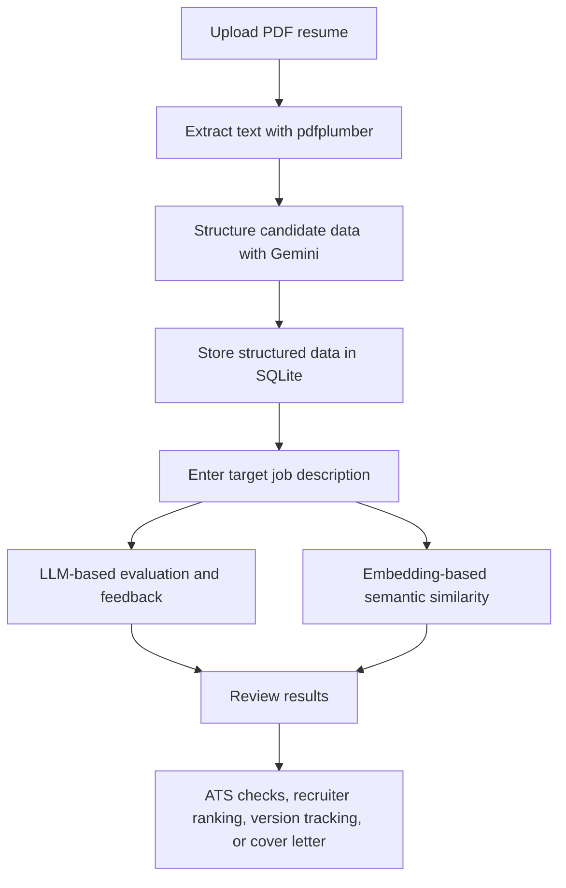

<div align="center">

# AI Resume Analyzer

**AI-powered resume analysis, semantic job matching, and recruiter screening**

A multi-page Streamlit application that transforms resume PDFs into structured candidate data, compares resumes with job descriptions, and provides AI-assisted feedback.

[](https://www.python.org/)
[](https://streamlit.io/)
[](https://ai.google.dev/)
[](https://www.sqlite.org/)
[](https://github.com/Supriya0213/ai_resume_analyzer)

**[View Repository](https://github.com/Supriya0213/ai_resume_analyzer)**

</div>

---

## Table of Contents

- [Overview](#overview)
- [Features](#features)
- [How It Works](#how-it-works)
- [Technology Stack](#technology-stack)
- [Project Structure](#project-structure)
- [Getting Started](#getting-started)
- [Environment Configuration](#environment-configuration)
- [Database Design](#database-design)
- [Design Decisions](#design-decisions)
- [Limitations](#limitations)
- [Roadmap](#roadmap)
- [Privacy and Security](#privacy-and-security)
- [Author](#author)

## Overview

**AI Resume Analyzer** is a multi-page application for candidates and recruiters. It extracts text from PDF resumes, structures key candidate information with a large language model (LLM), and evaluates relevance to a target job description using two complementary approaches:

1. **LLM-based evaluation** for contextual reasoning and feedback.
2. **Embedding-based semantic similarity** for comparing and ranking resumes efficiently.

The application also includes ATS-oriented checks, resume-version score tracking, recruiter mode, and AI-assisted cover-letter generation.

> **Important:** Similarity scores and ATS checks are decision-support signals. They are not a guarantee of interview selection and do not reproduce every employer's proprietary screening system.

## Features

| Feature | Description |
|---|---|
| **Resume Analyzer** | Extracts PDF text and uses an LLM to structure candidate details such as skills, experience, and education. |
| **Job Description Matching** | Evaluates resume relevance using LLM reasoning and embedding-based semantic similarity. |
| **ATS Compatibility Checks** | Checks selected resume signals that may affect automated parsing. |
| **Recruiter Mode** | Accepts multiple resumes and ranks them against one job description using embeddings. |
| **Resume Version Tracker** | Tracks scores for different resume versions against the same job and helps compare changes. |
| **Cover Letter Generator** | Creates a tailored cover-letter draft grounded in facts extracted from the resume. |
| **SQLite Persistence** | Stores resume records, extracted details, and score history in a relational database. |
| **API Resilience** | Includes retry behavior for transient Gemini API failures and fallback handling when a model is unavailable. |
| **Defensive LLM Parsing** | Handles model output cautiously because generated responses may not always be clean JSON. |


## How It Works



### Two complementary matching approaches

- **LLM reasoning** provides contextual feedback and can explain relevant experience or potential gaps.
- **Embeddings** represent text as vectors so resume/job-description similarity can be compared efficiently, including in recruiter mode.

The two approaches serve different purposes: LLM feedback is more explanatory, while embedding comparisons are useful for ranking multiple resumes with fewer model calls.

## Technology Stack

| Layer | Technology | Role |
|---|---|---|
| Application interface | Streamlit | Multipage web interface |
| Programming language | Python | Application logic |
| PDF parsing | `pdfplumber` | Extracts text from PDF resumes |
| LLM and embeddings | Google Gemini API (`google-genai`) | Structured extraction, feedback, and semantic representations |
| Data handling | pandas | Tabular data operations |
| Database | SQLite | Persistent resume data and score history |
| Schema | SQL | Defines related database tables |
| Version control | Git and GitHub | Source management and collaboration |

## Project Structure

Based on the project structure documented in the original README:

```text
ai_resume_analyzer/
├── app.py                    # Main page: analyze one resume
├── extract_data.py           # LLM extraction, matching, retry and model fallback
├── matching_utils.py         # Embeddings, cosine similarity and ranking
├── ats_checker.py             # ATS compatibility checks
├── database.py                # Creates the database from schema.sql
├── schema.sql                 # Database schema
├── requirements.txt           # Python dependencies
├── .env.example               # Example environment configuration
└── pages/
    ├── 1_Recruiter_Mode.py    # Rank multiple resumes
    ├── 2_Version_Tracker.py   # Track resume-version scores
    └── 3_Cover_Letter.py      # Generate a tailored cover letter
```

## Getting Started

### Prerequisites

- Python 3 installed
- `pip`
- A Google Gemini API key with access to a supported model
- Git, if cloning the repository

### 1. Clone the repository

```bash
git clone https://github.com/Supriya0213/ai_resume_analyzer.git
cd ai_resume_analyzer
```

### 2. Create and activate a virtual environment

**Windows — PowerShell**

```powershell
python -m venv venv
.\venv\Scripts\Activate.ps1
```

**Windows — Command Prompt**

```bat
python -m venv venv
venv\Scripts\activate.bat
```

**macOS / Linux**

```bash
python3 -m venv venv
source venv/bin/activate
```

### 3. Install dependencies

```bash
python -m pip install --upgrade pip
pip install -r requirements.txt
```

### 4. Configure your API key

Create a `.env` file in the project root, using `.env.example` as a reference. The documented variable is:

```env
GEMINI_API_KEY=your_api_key_here
```

Make sure the variable name matches what the code reads. Never commit your real `.env` file or API key.

### 5. Initialize the database

```bash
python database.py
```

### 6. Run the application

```bash
streamlit run app.py
```

Open the local URL printed in the terminal by Streamlit.

## Environment Configuration

- Keep secrets in environment variables rather than hard-coding them.
- Commit `.env.example` with placeholder values, not real credentials.
- Check that the Gemini model configured in the code is available to your API key.
- Keep dependencies listed in `requirements.txt` so setup is repeatable.

## Database Design

The database is normalized into related tables linked by `RESUME_ID` foreign keys.

| Table | Purpose |
|---|---|
| `RESUMES` | Stores resume ID, filename, raw text, and upload date. |
| `SKILLS` | Stores skills associated with each resume. |
| `EXPERIENCE` | Stores job title, company, dates, and experience description. |
| `EDUCATION` | Stores institution, degree, field of study, and year. |
| `SCORE_HISTORY` | Stores job name, version label, score, and creation timestamp. |

One resume can have multiple skills, experience entries, and education records. Keeping these as related records avoids repeating groups in a single row and makes the information easier to query.

## Design Decisions

- **Normalized relational data:** Skills, experience, and education are stored as related records rather than repeated lists in one resume row.
- **LLM for extraction, database for persistence:** The model handles inconsistent resume text, while SQLite preserves extracted information for reuse.
- **Two matching methods:** LLM evaluation provides contextual feedback; embeddings make it practical to compare multiple resumes efficiently.
- **API resilience:** The documented extraction layer retries transient `503` errors, avoids retrying `429` quota errors, and can fall back to another model when the first is unavailable.
- **Defensive output parsing:** The application removes Markdown fences where needed and parses model-generated JSON cautiously.
- **Grounded cover letters:** Cover-letter generation is constrained to facts present in the resume to reduce invented achievements.

## Limitations

- Embedding scores may cluster in a narrow range; relative rankings can be more useful than interpreting a score as a precise percentage.
- Re-uploading an already-processed resume reuses stored data but does not redisplay the structured JSON.
- The current application is a single-user local tool and does not include user accounts.
- Foreign keys do not yet use `ON DELETE CASCADE`.
- SQLite foreign-key enforcement and deletion behavior should be reviewed before expanding the application.
- Availability, quotas, and behavior of Gemini models depend on the provider and account.

## Roadmap

- [ ] Add real application screenshots and a short demo GIF.
- [ ] Add automated tests for extraction, matching, and ATS checks.
- [ ] Extract only relevant job requirements before embedding a job description.
- [ ] Add `ON DELETE CASCADE` and enable SQLite foreign-key enforcement.
- [ ] Improve user-facing handling of malformed PDFs and API failures.
- [ ] Add authentication and deploy with a hosted database.
- [ ] Evaluate matching quality on a documented, privacy-safe test set.
- [ ] Add clearer explanations of match scores and skill gaps.

## Privacy and Security

Resumes can contain sensitive personal and employment information.

- Use sample or consented resumes during testing and demonstrations.
- Do not commit private resumes, personal data, or database files containing sensitive records.
- Keep API keys out of source code, screenshots, and Git history.
- Review what information is sent to the AI provider before processing real resumes.
- Add authentication, access controls, and appropriate data-retention rules before multi-user deployment.

## Author

**Supriya Choudhary**

- GitHub: [@Supriya0213](https://github.com/Supriya0213)
- Project: [AI Resume Analyzer](https://github.com/Supriya0213/ai_resume_analyzer)

---

<div align="center">

**Built as a practical exploration of generative AI, semantic matching, Python, and relational database design.**

</div>
